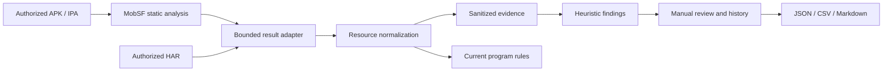

# Bug Bounty architecture

The existing MobSF engine remains the APK/IPA parser and analyzer. The new
`mobsf.BugBounty` Django app consumes persisted `StaticAnalyzerAndroid` and
`StaticAnalyzerIOS` results on explicit import. No network or device operation
is performed by an import.

## Internal interfaces

* `discovery.endpoint_record`: validates absolute HTTP/WebSocket URLs,
  canonicalizes IDNA host/default ports, preserves path distinctions, removes
  query values and fragments, produces a SHA-256 resource identity. Methods
  require observed HAR evidence; multiple methods are retained separately.
* `scope.validate_rules/classify`: exact hosts, boundary-aware subdomains and
  exclusions. Missing authorization metadata, unknown hosts, ambiguous paths
  and masked path identifiers remain UNKNOWN. Exclusions take priority.
* `services.import_core/import_har`: atomic imports, stable deduplication,
  sanitized evidence and preserved manual states. Core URLs retain file origins;
  resource/Smali/native strings are included when the core supplied them.
* `services.review_finding`: row lock, explicit justification, retained evidence
  required for CONFIRMED, immutable review events.
* `sanitization.sanitize`: nested field masking, known credential patterns,
  private keys, JWT, cookie/Authorization lines, common personal identifiers,
  conservative long-string masking. This is not a universal PII detector.

## Data model

Program has owner, scope JSON, source/date of authorization and approval flag.
Analysis has program, core MD5, package, version and platform. Endpoint has
resource identity, sanitized URL, host/path, observed methods, parameter names,
sources, observation flag, confidence and timestamps. Finding has stable
identity, kind, severity, confidence, rationale, review state and note. Evidence
has sanitized content, source, SHA-256 of supplied content and retention dates.
FindingEvent records actor, old/new state, justification and timestamp.

Unique constraints make imports idempotent. SQLite and PostgreSQL use the same
models. The committed initial migration is separate from the core's generated
StaticAnalyzer migrations. Default retention is 90 days; schedule
`manage.py purge_bounty_evidence` daily. Expired evidence is hidden immediately.

## Access and API

Owners access their own programs; superusers administer all programs. Importing
a core result additionally requires `StaticAnalyzer.can_scan`. Existing core
reports are platform-wide; this app does not retrofit ownership into legacy
MobSF scan tables. New routes ignore the core authentication-disable switch.
The global REST key cannot authorize this workspace.

All mutation routes require POST and a Django CSRF token. JSON APIs are under
`/bounty/api/`, so the legacy `/api/` global-key middleware does not apply.
Anonymous sessions are redirected to login. Cross-project IDs return 404.

| Route | Methods | Purpose |
| --- | --- | --- |
| `/bounty/api/programs/` | GET, POST | Paginated programs / create |
| `/bounty/api/programs/{id}/` | GET, POST | Read / update scope |
| `/bounty/api/programs/{id}/import/` | POST | Import core MD5 |
| `/bounty/api/analyses/{id}/` | GET | Paginated inventory and findings |
| `/bounty/api/analyses/{id}/har/` | POST | Passive HAR JSON import |
| `/bounty/api/analyses/{id}/findings/` | POST | Create manual finding |
| `/bounty/api/findings/{id}/` | GET, POST | Evidence/history / review |
| `/bounty/api/findings/{id}/evidence/` | POST | Add sanitized text evidence |
| `/bounty/analyses/{id}/export/{json,csv}/` | GET | Inventory download |
| `/bounty/analyses/{id}/compare/{other}/` | GET | Same-app version differences |
| `/bounty/findings/{id}/report/{json,md}/` | GET | Research report download |

Use session cookies and `X-CSRFToken` for JSON POSTs. Limits: 2 MiB request/core
field, 4,000 extracted endpoint references per core import, 1,000 HAR entries,
1,000 secret/rule findings, 200 scope rules per category, depth 12.
Exports omit parameter values; CSV neutralizes spreadsheet formula prefixes.
Report exports are research records, not complete submission templates.
