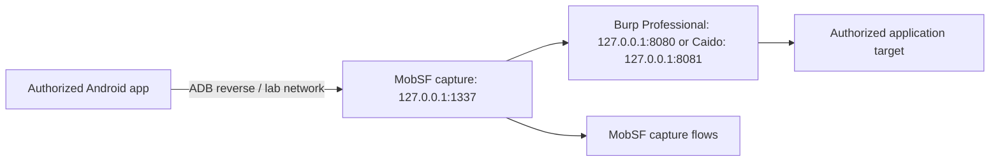

# Burp Suite Professional and Caido integration

This edition supports native HTTP(S) capture forwarding and passive capture
imports. Burp/Caido remain independently installed applications; no license,
provider API key, paid scanner API or extension is bundled.

## Native capture chain



The integration uses a dedicated capture setting. Package updates, JADX downloads
and other MobSF provider requests do not automatically enter Burp/Caido history.
Existing `MOBSF_UPSTREAM_PROXY_*` settings still control those provider requests;
they no longer configure the dynamic capture chain.

1. Start Burp's proxy listener on `127.0.0.1:8080`, or configure Caido's HTTP
   proxy listener on `127.0.0.1:8081`. Port 8081 is a suggested separate listener,
   not a claim about Caido's default. Use the actual listener port you configured.
2. Set interception to forward requests while checking connectivity. If intercept
   is enabled, requests pause until you explicitly forward them. Restrict the
   proxy project/target scope to your authorized lab. Avoid upstream rules that
   route traffic back to MobSF port 1337.
3. Export the selected proxy's root CA and convert it to PEM if required. Save
   only its public certificate in a private local configuration directory.
4. Edit `%APPDATA%\MobSF-BugBounty\desktop.env`, retaining the existing password
   and Android settings. Add or edit these lines for Burp:

```dotenv
MOBSF_CAPTURE_PROXY_PROVIDER=burp
MOBSF_CAPTURE_PROXY_URL=http://127.0.0.1:8080
MOBSF_CAPTURE_PROXY_CA_FILE=C:\Users\YOUR_USER\Certificates\burp-ca.pem
```

For Caido, use `provider=caido`, its configured URL and its own exported CA:

```dotenv
MOBSF_CAPTURE_PROXY_PROVIDER=caido
MOBSF_CAPTURE_PROXY_URL=http://127.0.0.1:8081
MOBSF_CAPTURE_PROXY_CA_FILE=C:\Users\YOUR_USER\Certificates\caido-ca.pem
```

For a DER certificate exported by Burp, Windows can convert it without an
additional OpenSSL installation:

```powershell
certutil -encode 'C:\Users\YOUR_USER\Certificates\burp-ca.der' 'C:\Users\YOUR_USER\Certificates\burp-ca.pem'
```

Use the same conversion for a Caido DER certificate. An already PEM-encoded
certificate does not need conversion.

Substitute your real certificate path; values in desktop.env are literal and do
not need surrounding quotes. Providers are `none`, `burp`, `caido` and `custom`.
URLs accept explicit IPv4/IPv6 addresses and HTTP proxy listeners, with no user
info, path or query. An IPv6 address uses brackets. The default provider is
`none`; stop/restart the native server to apply changes.

```powershell
./MobSF-BugBounty.exe proxy-check
./MobSF-BugBounty.exe android-check
./MobSF-BugBounty.exe start
```

`proxy-check` validates the URL and optional CA, then opens only a TCP connection
to the configured listener. It sends no application requests and does not claim
HTTPS interception works. Invalid settings, malformed CA files, an unreachable
listener or a direct loop to MobSF fail explicitly. Listener availability,
Android readiness and successful HTTPS interception are separate checks.

The capture runner verifies upstream HTTPS certificates. Importing Burp/Caido's
CA supplies explicit trust; verification is never disabled with `-k`. Without
that CA, HTTPS interception by the external proxy fails while plain HTTP can
still work. A public CA file is different from a client certificate and from
the Android app's trust configuration.

## Android trust and capture

Start an authorized Dynamic Analysis session in MobSF. For native emulator/USB
capture, MobSF can use ADB reverse from the device port to host port 1337. An app
that uses the Android proxy forwards through MobSF, then the selected external
proxy. VPN transports, apps ignoring the system proxy, QUIC, certificate pinning
and isolated networking can prevent that traffic from entering the chain.

Android must trust the MobSF capture CA under
`%APPDATA%\MobSF-BugBounty\data\mitmproxy\mitmproxy-ca-cert.pem` for this chain.
The external proxy's CA belongs to the host-side upstream trust bundle. For an
app routed directly to Burp/Caido instead, it needs that proxy's trust in its lab
build/device and MobSF will not simultaneously capture those flows. Modern
Android automatic system-CA mutation remains unavailable. Use an authorized
debug build with an appropriate network-security configuration or an explicitly
prepared rooted lab; see ANDROID_COMPATIBILITY.md.

Capture flows and raw HTTPtools traffic text are stored under `data/traffic/`;
they can contain sensitive application traffic. The capture UI uses the same
folder and binds to the configured local proxy IP. Runner errors go to
`data/capture-proxy.log`; certificate errors remain visible there. Workspace
imports apply the separate redaction rules below.

## Passive imports into the workspace

Open an existing analysis in Bug Bounty Workspace and choose a capture format:

| Tool / capture | Export to use | Workspace selection |
| --- | --- | --- |
| Burp Suite Professional | Select HTTP history items, use Save items, retain request data (base64 is accepted) | Burp Suite Professional XML |
| Caido | Export selected authorized HTTP traffic as HAR | Caido HAR |
| Browser or other HAR exporter | Standard HAR `log.entries` | HAR |

Burp project files, issue-export XML, Caido project archives and PCAP files are
not these formats. If a Caido installation does not offer HAR export, convert
selected traffic to standard HAR using its supported exporter before importing.
No external provider API is required or assumed.

Limits: 2 MiB and 1,000 entries. Burp XML rejects DTDs/entities; request header
blocks are limited to 64 KiB/200 headers. Raw request/response bodies are omitted,
header values redacted and URL parameter values removed. Source labels retain
Burp/Caido provenance. Imports are passive, deduplicate endpoints, enforce
project ownership and CSRF, and do not replay traffic or mark findings confirmed.
The existing `/bounty/api/analyses/<id>/har/` endpoint accepts multipart `har`
with `format=burp`, `caido` or `har`. Existing JSON HAR clients remain compatible.

## Executed checks and limits

The local synthetic chain test exercises real mitmproxy HTTP forwarding, accepts
HTTPS with the configured fixture CA and rejects an untrusted upstream CA. The
same test is included in Windows CI, alongside native executable operation.
It emulates interception listeners using owned loopback fixtures; it does not
establish an executed Burp Professional/Caido desktop session or a physical
Android TLS session. TEST_RESULTS.md records completed checks separately.
